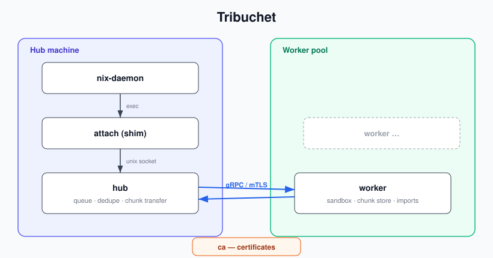

# Tribuchet

Remote build execution for Nix, built on the experimental
`external-builders` feature. A hub next to the nix-daemon hands builds
to remote workers. Workers run them in their own sandboxes and stream
logs and outputs back to the waiting `nix build`.



> **Status: experimental.** It depends on Nix's experimental
> `external-builders` feature (plus a small patch for uid-range builds).
> Protocol and configuration may still change.

## Why not `--builders` / the SSH build hook?

The classic remote build protocol needs SSH reachability into every
builder and Nix installed there, and it copies closures without any
scheduling. Tribuchet receives the complete build environment from Nix
and owns transfer, scheduling and execution itself.

## Features

- Workers dial the hub over gRPC with mutual TLS, so they can sit
  behind NAT. They register the systems and features they serve.
- Hub scheduling with per-system queues and capability matching
  (`kvm`, `uid-range`, `big-parallel`, …). Identical submissions share
  one build.
- Inputs and outputs travel as content-defined chunks, and only the
  chunks the other side lacks. No store-path rewriting.
- Builds survive hub and worker restarts and reloads, so deploys don't
  kill in-flight builds. A build is cancelled when its `nix build`
  goes away.
- Sandboxing equivalent to Nix's own: Linux namespaces with per-build
  cgroup limits, macOS Seatbelt under per-build users. Adds
  `uid-range` builds and cross-system user-mode emulation.
- Fixed-output derivations get network through [presto-pasta], an
  embedded user-mode NAT, in an otherwise isolated network namespace.
  An optional allow/deny flow policy (`fod-network`) filters
  destinations.
- Live build logs across reloads and restarts, with `max-log-size`,
  `max-silent-time` and timeout enforcement.
- NixOS and nix-darwin modules for both services, and an OCI worker
  image for hosts without Nix.

[presto-pasta]: https://github.com/Mic92/presto-pasta

## Getting started

Tribuchet is one binary with four subcommands: `hub`, `worker`,
`attach` (the shim Nix execs) and `ca`.

### 1. Certificates

Workers authenticate to the hub with client certificates from a
private CA:

```console
$ tribuchet ca init   --dir ./ca
$ tribuchet ca issue hub     --dir ./ca   # SAN must match the hub address workers dial
$ tribuchet ca issue worker  --dir ./ca   # one per worker
```

The hub reads `hub.crt`, `hub.key` and `ca.crt` from `<config-dir>/ca`
(default `/etc/tribuchet/ca`). Each worker gets `ca.crt` plus its own
key pair (default `/var/lib/tribuchet/tls/`).

Alternatively set `auth = "tailscale"` on both sides to skip TLS. The
worker dials `http://<hub-tailnet-name>:7437`. The hub looks each peer
up in tailscaled's LocalAPI, rejects anything not on the tailnet, and
uses the node name as the worker identity. Restrict registration to
ACL tags with `tailscale-allowed-tags = ["tag:tribuchet-worker"]`.

The hub knows a reconnecting worker by name: the hostname it reports
(not anything in its certificate), or with `auth = "tailscale"` its
tailscale node's short name. No two workers may share a name, nor two
workers one tailscale node. The hub does not check, so a shared name
goes unnoticed, and a build kept for its worker through the reconnect
grace can be released while that worker still runs it, and run twice.
Give each worker its own hostname, and a container `--hostname`:
podman otherwise uses its ID, new on every recreate, or with
`--network=host` the host's own hostname.

### 2. Hub (on the machine running nix-daemon)

`/etc/tribuchet/hub.toml`:

```toml
socket = "/run/tribuchet/hub.sock"   # for tribuchet attach
listen = "0.0.0.0:7437"              # for workers
config-dir = "/etc/tribuchet"
```

Point Nix at the attach shim in `nix.conf`:

```
experimental-features = external-builders
external-builders = [{"systems":["x86_64-linux","aarch64-linux"],"program":"/path/to/tribuchet-attach"}]
```

where `tribuchet-attach` is a wrapper script:

```sh
#!/bin/sh
exec tribuchet attach "$1" --socket /run/tribuchet/hub.sock
```

### 3. Workers

A worker needs its own nix-daemon. Inputs are imported through it and
held by temp roots against garbage collection. The worker runs
unprivileged and leases each build to a per-uid agent service (set up
by the NixOS and nix-darwin modules) that owns the builder process and
its uid block.

`/etc/tribuchet/worker.toml`:

```toml
hub = "https://hub.example.org:7437"
max-jobs = 4
max-log-size = 67108864

[emulate]
aarch64-linux = "/path/to/static/qemu-aarch64"
```

```console
$ tribuchet worker --config /etc/tribuchet/worker.toml
```

Hub and worker each keep a chunk cache under `XDG_CACHE_HOME/tribuchet`,
10 GiB by default. A warm worker only receives chunks it does not
hold. Tune with `chunk-cache-bytes` (hub) and `chunk-store-bytes`
(worker). The cache can be deleted while the process is stopped.

All options for both files are documented in
[`crates/tribuchet/src/config.rs`](crates/tribuchet/src/config.rs).

The worker's TLS paths can be overridden with `TRIBUCHET_CA_CERT`,
`TRIBUCHET_CERT` and `TRIBUCHET_KEY`, e.g. to point at a key delivered
by systemd `LoadCredential`. The NixOS module's
`services.tribuchet-worker.keyFile` does this.

### NixOS

Import `tribuchet.nixosModules.default` (flake input
`github:Mic92/tribuchet`) and enable the services:

```nix
{
  # hub machine
  services.tribuchet-hub.enable = true;
  # optional: route this machine's nix-daemon builds through the hub
  services.tribuchet-hub.externalBuilders = {
    enable = true;
    systems = [ "x86_64-linux" "aarch64-linux" ];
  };

  # worker machines
  services.tribuchet-worker = {
    enable = true;
    settings = {
      hub = "https://hub.example.org:7437";
      # Concurrent builds. Defaults to the core count at runtime, up
      # to 64 (32 on darwin). Set explicitly to go beyond or below.
      # max-jobs = 128;
    };
  };
}
```

The hub unit is socket-activated. The worker unit reloads instead of
restarting on package or settings changes, so running builds survive
deploys.

### macOS (nix-darwin)

`tribuchet.darwinModules.default` provides the same two services for
launchd. The hub adopts its sockets from launchd. The worker daemon
execs through a stable symlink that activation flips and then SIGHUPs,
which again keeps builds alive across upgrades.

### Container

For hosts without Nix the flake builds an OCI image,
`packages.x86_64-linux.worker-image`. CI publishes the same image for
x86_64-linux and aarch64-linux as `ghcr.io/mic92/tribuchet-worker`,
tagged `main` and per release. It carries its own Nix store,
starts a nix-daemon and the worker, and spawns build agents according
to `spawn-agents` and `agent-uid-base` in worker.toml. It needs no
added capabilities, but the sandbox creates namespaces and mounts,
which the default runtime seccomp profile forbids. Use the profile
from `packages.x86_64-linux.seccomp-profile` and unmask /proc:

```console
$ podman run -d --name tribuchet-worker \
    -v /etc/tribuchet:/etc/tribuchet:ro \
    -v tribuchet-nix:/nix \
    --security-opt seccomp=$(nix build --print-out-paths .#seccomp-profile) \
    --security-opt unmask=ALL \
    ghcr.io/mic92/tribuchet-worker:main
```

The one extra syscall rule the sandbox needs is also available on its
own in [`nix/seccomp-additions.json`](nix/seccomp-additions.json), to
append to a base profile of your choice.

For docker replace `unmask=ALL` with `systempaths=unconfined`. On
Kubernetes ship the profile as a `Localhost` seccomp profile, or fall
back to `Unconfined`, and set `procMount: Unmasked`.

Compared to the NixOS module the agents get no delegated cgroup, so
`build-memory-max` and uid-range builds are unavailable. The `/nix`
volume is only a cache. The daemon garbage-collects it via the
`min-free` and `max-free` settings baked into the image.

## Prometheus metrics

Set `metrics-listen = "127.0.0.1:7438"` in `hub.toml` and the hub serves
`/metrics` there, over plain HTTP.

| metric | type | labels | meaning |
|---|---|---|---|
| `tribuchet_builds_submitted_total` | counter | | builds accepted for scheduling |
| `tribuchet_builds_declined_total` | counter | | builds declined because no capable worker registered in time |
| `tribuchet_builds_requeued_total` | counter | | builds requeued after a worker session was lost |
| `tribuchet_builds_failed_total` | counter | | builds that ended in failure |
| `tribuchet_builds_succeeded_total` | counter | | builds that completed |
| `tribuchet_system_builds` | gauge | system, state = queued, running | builds in each state. Sum the `queued` series for the queue depth |
| `tribuchet_system_slots` | gauge | system | build slots of connected workers. A worker serving several systems counts in each. Free slots are `slots - running` |
| `tribuchet_workers_connected` | gauge | | workers with an open session |
| `tribuchet_workers_for_system` | gauge | system | connected workers advertising a system |
| `tribuchet_queue_seconds` | histogram | system | time a build waited for a worker, per attempt. Its `_count` is the number of dispatches |
| `tribuchet_build_seconds` | histogram | system | wall time of a build on its worker |
| `tribuchet_build_cpu_seconds` | histogram | system | CPU time of a build |
| `tribuchet_build_peak_memory_bytes` | histogram | system | peak memory of a build |
| `tribuchet_worker_messages_total` | counter | type | messages received from workers |
| `tribuchet_worker_message_bytes_total` | counter | type | encoded bytes of those messages |

`GET /workers` on the same port lists the connected workers as indented
JSON, sorted by name, with `name`, `systems` and their features, `max_jobs`
and `connected_seconds`.

## Fixed-output network policy

On Linux workers with `/dev/net/tun`, fixed-output builds run in a
private network namespace and reach the outside through the embedded
[presto-pasta] user-mode NAT. The worker's loopback services and
abstract sockets are never reachable from there. On top of that the
optional `fod-network` setting filters which destinations such builds
may connect to. It lives in the worker's freeform settings, so with
the NixOS module it is plain Nix:

```nix
services.tribuchet-worker.settings.fod-network = {
  # action when no rule matches (default: "allow")
  default = "allow";

  # ordered rules, first match wins
  rules = [
    {
      action = "deny";
      dst = "private"; # loopback, RFC 1918, link-local, ULA, CGNAT, ...
    }
    {
      action = "allow";
      dst = "10.20.0.15"; # single IP or CIDR, IPv4 or IPv6
      ports = [ "443" ];
    }
    {
      action = "deny";
      proto = "tcp"; # "tcp", "udp" or "any" (default)
      dst = "any";
      ports = [
        "25"
        "465"
        "587"
        "8000-8999"
      ];
    }
  ];
};
```

Without the module the same structure goes into worker.toml as a
`[fod-network]` table with `[[fod-network.rules]]` entries.

Each rule matches on the destination of a new outbound connection:

- `dst`: `"any"`, `"private"` (everything non-public: loopback,
  RFC 1918, link-local, ULA, CGNAT, multicast), a single IP, or a CIDR
  like `"192.0.2.0/24"` or `"2001:db8::/32"`.
- `proto`: `"tcp"`, `"udp"` or `"any"`.
- `ports`: destination ports, single (`"443"`) or inclusive ranges
  (`"8000-8999"`). Empty or omitted means any port.

Rules are evaluated in order for every new flow before a host socket
is created. Denied connections never leave the sandbox: a TCP SYN gets
no answer. Rules are IP-based on purpose. Hostname rules would only
apply to whatever a name resolves to at connect time, and a build
resolving names itself bypasses them trivially. presto-pasta forwards
DNS lookups to the host resolver independently of these rules, so a
`deny` rule cannot break name resolution.

## How a build flows

1. Nix execs `tribuchet attach build.json`. The shim submits the build
   to the hub over the unix socket.
2. The hub validates and dedupes the request and queues it for a
   worker serving that system and feature set.
3. The assignment lists the input closure. The worker answers with the
   paths and chunks it lacks, the hub streams those chunks, and the
   worker imports the paths through its nix-daemon.
4. The worker runs the builder in its sandbox. Logs stream live back
   to `nix build`.
5. The worker announces each output's chunk list. The hub fetches the
   chunks it lacks, assembles and verifies the NAR, and unpacks it at
   the scratch path Nix provided. Nix finishes hashing and
   registration as if the build had run locally.

[`DESIGN.md`](DESIGN.md) describes the architecture, sandbox, security
model and failure handling in detail. [`spec/`](spec/) holds Quint
models of worker staging and the transfer protocol, proven as flake
checks.

## Development

```console
$ nix develop            # rust toolchain + protobuf
$ cargo test
$ cargo clippy --all-targets
$ nix build .#checks.x86_64-linux.nixos-test-builds     # end-to-end VM test (hub + worker)
$ nix build .#checks.x86_64-linux.nixos-test-nspawn     # NixOS-container build in the sandbox
$ nix build .#checks.x86_64-linux.nixos-test-lifecycle  # daemon restart/reload/stop sequence
$ nix build .#checks.x86_64-linux.spec-protocol         # inductive proof of spec/protocol.qnt
```

The VM tests exercise remote builds, hub and worker restarts and
reloads mid-build, cancellation, log limits, uid-range and emulated
builds, and fixed-output networking.

## License

[MIT](LICENSE)
